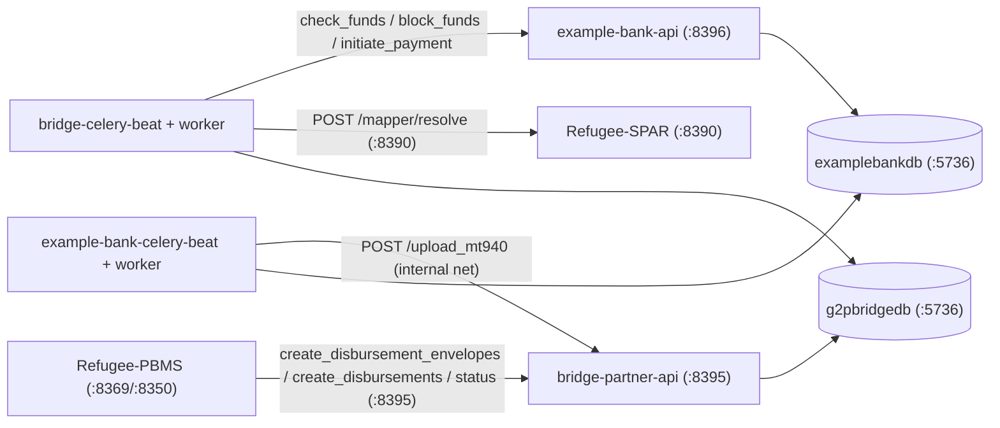

# Architecture

`Refugee-G2P-Bridge` is a standalone Docker Compose stack (`COMPOSE_PROJECT_NAME=refugee-g2p-bridge`) with its own network (`refugee_bridge_net`) and volumes (`refugee_bridge_postgres_data`, `refugee_bridge_redis_data`).

